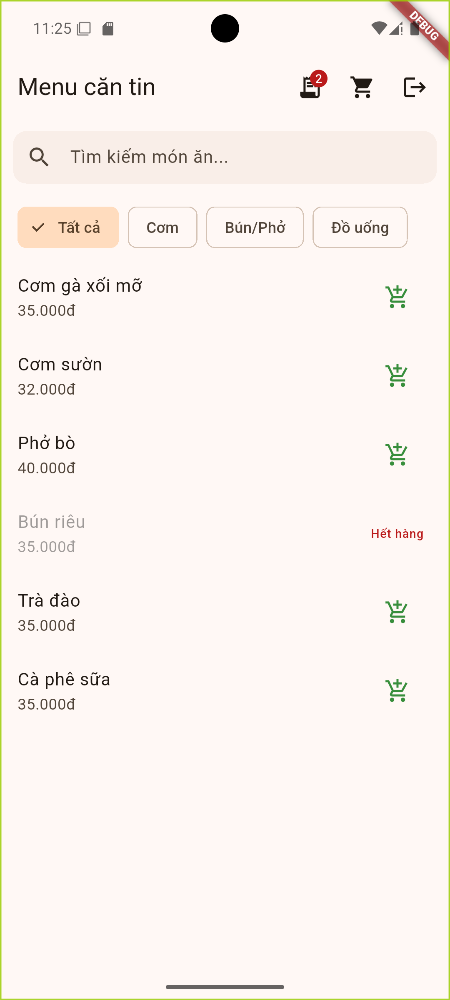
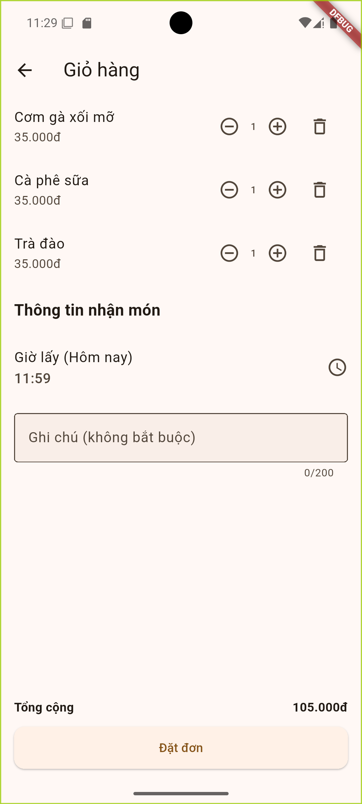
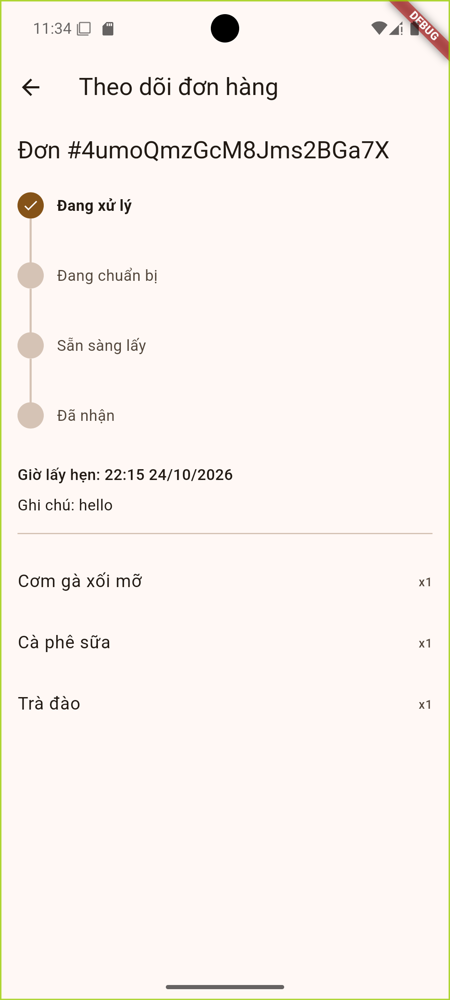
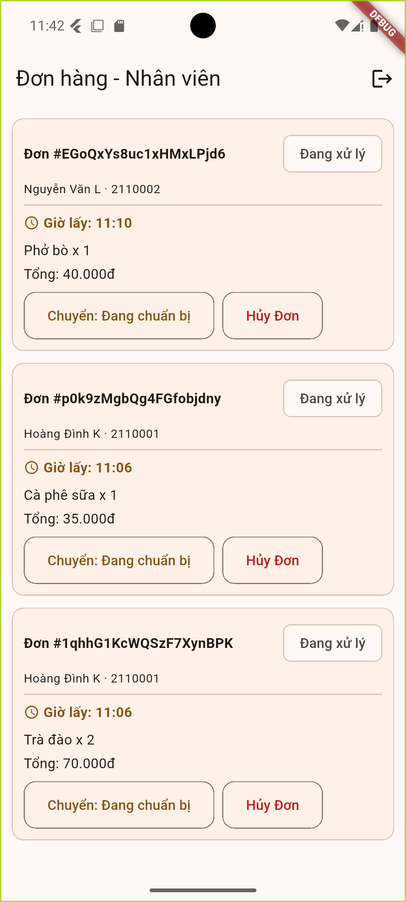

# Canteen App

A canteen food-ordering app built with Flutter and Firebase. Students browse the menu, place an order ahead of time and track it; canteen staff receive orders and update their status. Both sides see changes almost instantly.

This is a personal project for practicing Flutter. It is fairly simple and still has plenty of rough edges (see [Limitations](#limitations)). Part of the code was written with the help of AI.

<table>
  <tr>
    <td align="center"><br><sub>Menu</sub></td>
    <td align="center"><br><sub>Cart and pickup time</sub></td>
  </tr>
  <tr>
    <td align="center"><br><sub>Order tracking</sub></td>
    <td align="center"><br><sub>Staff screen</sub></td>
  </tr>
</table>

## Features

**Students**

- Sign in with an ID and password
- Browse the menu, filter by category, search for dishes
- View dish details and add dishes to the cart
- Place an order with a pickup time and a note
- Track the order status in real time (animated timeline)
- "My orders" button to reopen orders that are still in progress
- Get a notification when an order changes status (Android)

**Staff**

- See the list of active orders, updated automatically when new ones arrive
- Move an order through its statuses in the correct order, or cancel it

**General**

- Responsive layout for phones, tablets and browsers
- Offline banner, write actions blocked while offline, previously loaded data still viewable
- Loading shimmer and smooth page transitions

Order status flow: `pending → preparing → ready → completed`. An order can only be cancelled while it is `pending` or `preparing`.

## Tech stack

| Part             | Technology                  |
| ---------------- | --------------------------- |
| App              | Flutter / Dart              |
| Authentication   | Firebase Authentication     |
| Database         | Cloud Firestore             |
| State management | Provider                    |
| Notifications    | flutter_local_notifications |
| Connectivity     | connectivity_plus           |
| Loading effect   | shimmer                     |

The code follows an MVVM + Repository structure: screens only display things, ViewModels hold state and logic, and Repositories handle reading and writing data. Repositories come in a Mock version (used in tests) and a Firestore version (used when running for real).

## Getting started

You need [Flutter](https://docs.flutter.dev/get-started/install) installed. On Windows, turn on Developer Mode so the plugins can build.

The app needs a Firebase project of your own:

1. Create a project in the [Firebase Console](https://console.firebase.google.com), then enable **Authentication** (Email/Password) and **Cloud Firestore**.
2. Connect the app to your Firebase project:
   ```bash
   dart pub global activate flutterfire_cli
   flutterfire configure
   ```
   This regenerates `lib/firebase_options.dart` for your project.
3. Paste the contents of `firestore.rules` into Firestore → Rules and publish them.
4. Create test accounts under Authentication. The sign-in ID is turned into an email of the form `<id>@canteen.local`, so ID `2110001` maps to `2110001@canteen.local`.
5. For each account, create a Firestore document `users/<uid>` with the fields `name`, `mssv` (mssv: student ID) and `role`. See `lib/data/models/user_role.dart` for the valid `role` values.
6. Run the app:
   ```bash
   flutter pub get
   flutter run -d chrome
   ```

To try both roles at the same time, open two terminals: one for an Android emulator (student) and one for Chrome (staff):

```bash
flutter run -d emulator-5554
flutter run -d chrome
```

Notifications only work on Android.

## Testing

```bash
flutter test
flutter analyze
```

Tests use the Mock repository, so no Firebase connection is needed. There is also a small tool, `tool/rules_check.dart`, that tries a set of allowed and forbidden operations against the Security Rules:

```bash
flutter run -d chrome -t tool/rules_check.dart
```

The tool creates a few test orders (with the note `rules-check`) and cancels them itself; any leftovers can be deleted by hand in the Console.

## Project structure

```
lib/
  core/        theme, shared widgets, notifications, connectivity
  data/        models and repositories (Mock, Firestore)
  features/    auth, menu, cart, orders, staff
firestore.rules      Firestore security rules
tool/                rules checking tool
test/                tests
```

## Limitations

- The menu is sample data inside the app, not stored in Firestore, so staff cannot mark dishes as sold out yet.
- Notifications only arrive while the app is open or running in the background. Receiving them when the app is fully closed would need Firebase Cloud Messaging and Cloud Functions.
- Dish prices and order totals are calculated in the app and sent as-is; they are not re-checked on the server side.
- There is no sign-up screen (accounts are created by hand in the Firebase Console).
- Students cannot cancel their own orders yet, and there is no order history.
- The offline banner only knows whether the device is connected, not whether it can actually reach the internet.
- Not tested on iOS.

## What could come next

- Move the menu to Firestore and add a "sold out" switch for staff
- Push notifications when the app is closed
- Let students cancel their own orders and see an order history
- Sign-up
